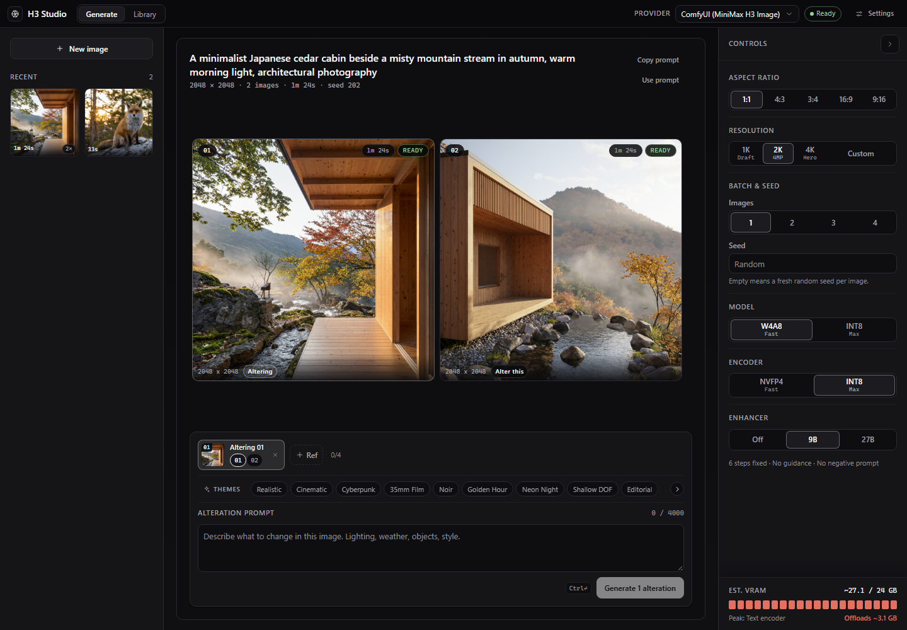
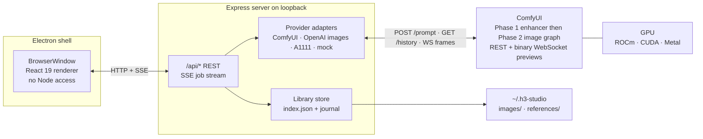

<div align="center">

# H3 Studio

**Local desktop studio for MiniMax H3 Image.** Native Electron app with live diffusion previews, vision-aware prompt enhancement, and hardware-aware auto-tuning.




</div>

H3 Studio runs on your machine, drives a local ComfyUI server, and keeps every image it makes. Nothing leaves the computer unless you point a provider at a remote address. It is built around the MiniMax H3 Image graph, not around one vendor: controls are rendered from what the connected provider says it can do, so a provider without seeds or negative prompts never shows those controls.

The app is one Electron window over a loopback HTTP server. The server owns the library, the provider adapters, the ComfyUI job stream and the hardware profiler. The renderer is a React 19 single page app with no Node access at all.

## Highlights

**Hardware-aware Setup Wizard and auto-tuning.** One scan reads the GPU (AMD ROCm, NVIDIA CUDA, Apple Metal or CPU), exact VRAM, system RAM, CPU, ComfyUI version and PyTorch build, plus every model file ComfyUI can see. The wizard then writes the matching ComfyUI launch flags (`--reserve-vram`, `--cache-none`, pinned memory, `--lowvram`, `--preview-method latent2rgb`) and environment (`TORCH_ROCM_AOTRITON_ENABLE_EXPERIMENTAL=1` on ROCm) straight into `providers.json`, keeping any custom `--port` or `--listen`.

**Live step-by-step previews and a rich pipeline view.** ComfyUI binary WebSocket frames are decoded and streamed over SSE: each tile shows a latent preview that sharpens as the sampler advances, alongside node readouts, the real pipeline phases, rolling seconds per step, an ETA, and the duration each stored image actually took.

**Two-phase, vision-aware prompt enhancement.** The `Qwen3.5 9B` or `Qwen3.8 27B H3 PE` enhancer is extracted into its own Phase 1 subgraph, so the 32B text encoder and the diffusion weights never sit in memory together. Phase 2 runs the image graph with the finished caption. Reference edits (up to `<Picture 1>`..`<Picture 4>`) are wired into the enhancer itself, and the exact provider rewrite is shown next to the prompt it replaced.

**Multi-precision and multi-seed controls.** Switch the diffusion weights between `W4A8` (11.7 GB) and `INT8 ConvRot` (19.5 GB), and the 32B text encoder between `NVFP4 AWQ` (14.6 GB) and `INT8 ConvRot` (25.3 GB). A 2 to 4 image batch shares one text encoding and fans out into per-seed samplers, so three images cost one encode instead of three.

**Studio library and inspector.** The viewer zooms to 8x at the cursor, drags to pan, holds `Space` for a before/after comparison, and walks the batch with the arrow keys. The left rail deletes a batch in one click, and any selection exports as a ZIP.

## Hardware tiers

The recommender is a pure function of what was measured, so the same machine always gets the same plan. These are the four plans it writes.

| Tier | VRAM | Example card | Recommended models | Canvas | Launch flags |
|---|---|---|---|---|---|
| Extreme | 30 GB+ | RTX 5090 32 GB, RTX PRO 48 GB | INT8 ConvRot diffusion, NVFP4 text encoder, Qwen3.8 27B enhancer | 4096 x 4096 | `--reserve-vram 2 --preview-method latent2rgb`, smart and pinned memory on |
| High | 20 to 30 GB | RX 7900 XTX 24 GB, RTX 4090, RTX 3090 | W4A8 diffusion, NVFP4 text encoder (INT8 when NVFP4 is absent), 27B enhancer | 2048 x 2048 | `--reserve-vram 4 --cache-none --disable-smart-memory`, pinned memory off below 28 GB RAM; on a DynamicVRAM build only `--reserve-vram 4 --preview-method latent2rgb` |
| Mid | 14 to 20 GB | RTX 4080, RTX 5070 Ti, RX 7800 XT | W4A8 diffusion, NVFP4 text encoder, Qwen3.5 9B enhancer | 2048 x 2048 | `--reserve-vram 3 --cache-none --disable-pinned-memory --disable-smart-memory` |
| Entry | under 14 GB or unknown | 12 GB cards, CPU fallback | W4A8 diffusion, NVFP4 or INT8 text encoder, enhancer off or 9B | 2048 x 2048 (1024 x 1024 draft) | `--lowvram --reserve-vram 2 --cache-none --disable-pinned-memory --disable-smart-memory` |

Cards under 30 GB, AMD included, get the 14.6 GB NVFP4 AWQ text encoder (INT8 ConvRot only when NVFP4 is not on disk or the card is a 30 GB+ class part), and every AMD plan also sets the ROCm AOTriton flash attention switch.

On a DynamicVRAM capable build (PyTorch 2.8+ on CUDA, or PyTorch 2.8+ with a ROCm 7.14+ wheel such as ROCm 10.2 on `2.14.0+rocm10.2.0`), the High plan omits `--cache-none` and `--disable-smart-memory` so ComfyUI's smart memory and prompt cache stay enabled: repeat runs are much faster and 4096 x 4096 (16 MP) renders stay safe on a 24 GB card. On older runtimes (for example `2.9.1+rocm7.2.1`) or when the PyTorch version cannot be read, the conservative flags are kept. Every plan is editable afterwards: reserved VRAM (2 to 8 GB), live previews, pinned memory and the ROCm switch are all in Settings, under Performance & Defaults.

## Quick start

Requirements: Node 24 or newer and npm. A GPU is optional (the mock provider runs anywhere), and ComfyUI is only needed for real generation.

```powershell
git clone https://github.com/Atroxit/H3-Studio.git
cd H3-Studio
npm install
```

Development, with hot reload and both servers in one terminal:

```powershell
npm run dev
```

The API listens on `http://127.0.0.1:4317` and Vite serves the UI on `http://127.0.0.1:4318`. Open the Vite URL. Ctrl+C stops both.

The desktop app, in its own window with no browser chrome:

```powershell
npm run desktop:build
npm run desktop
```

`desktop:build` builds the web app and bundles the server into `dist/server/main.cjs`; `desktop` launches the Electron shell, which picks a free loopback port and runs the server as a child process that stops when the window closes.

Optionally, add a Windows Desktop shortcut that launches the packaged app:

```powershell
npm run desktop:shortcut
```

That writes `H3 Studio.lnk` to your Desktop, pointing at `node scripts/desktop.mjs` with the repository as its working folder and the bundled icon. Pass `-Destination <folder>` to put it somewhere else.

### First run

1. Start ComfyUI. The studio can also start it for you: enable Auto-start on the provider, then set the command, working folder, arguments and environment.
2. Open **Settings**, then **Setup Wizard**. Step 1 scans the hardware, step 2 lists the seven official H3 files with sizes, VRAM fit and download links, step 3 previews the tuned defaults and launch flags before you apply them.
3. Press **Apply optimal settings**. The launch flags are written to `providers.json` and the studio defaults (canvas, precision, text encoder, enhancer) are applied to the Generate screen immediately.

The offline **Mock** provider is enabled by default, so the studio is usable before any model is installed. Its images are synthetic gradients; a prompt containing `FAIL_ONE` fails one item on purpose to exercise partial batches and retry.

## Architecture



The server never binds a public interface: everything is `127.0.0.1`. Every mutation is appended to `journal.ndjson` before it is applied, and the in-memory index is rebuilt from the snapshot plus the journal, so a second process or a polling browser cannot lose a write.

## Project layout

```text
electron/            Electron main process, window and menu, bundled icon
scripts/             dev pair runner, desktop launcher, shortcut, screenshot helper
src/core/            types, PNG and ZIP encoders, library store, provider adapters
src/core/providers/  comfyui, openai-images, a1111, mock, registry
src/server/          express app, job hub, launcher, settings, hardware profiler
src/web/             React studio shell and the generate, library and settings features
tests/unit           pure logic: store, PNG, ZIP, helpers, recommender, preferences
tests/integration    adapters against stub servers, the HTTP API over a real socket
tests/e2e            the real server and the mock provider, end to end
docs/                API contract, ComfyUI graph references, research notes, screenshots
```

## Scripts

| Script | What it does |
|---|---|
| `npm run dev` | API server and Vite dev server together, output prefixed `[api]` and `[web]` |
| `npm run typecheck` | `tsc --noEmit` over the whole repository, tests included |
| `npm run test` | Vitest unit and integration suites (321 tests) |
| `npm run test:e2e` | Vitest e2e suite against the real server and the mock provider (5 tests) |
| `npm run build` | Vite production build into `dist/web` |
| `npm run desktop:build` | Web build plus the esbuild server bundle at `dist/server/main.cjs` |
| `npm run desktop` | Build, then open the Electron shell |
| `npm run desktop:shortcut` | Write a Windows Desktop shortcut for the packaged app |
| `npm run verify` | Typecheck, test and build in one pass |
| `npm start` | Run the server alone from TypeScript, on port 4317 |

The 321 vitest tests cover the library store and its journal, PNG and ZIP encoding, the mock provider, the ComfyUI and HTTP adapters against stub servers, the HTTP API over a real loopback socket, the hardware recommender across all four tiers, and the pure UI helpers (progress folding, durations, preferences, launch argument and environment parsing). The e2e suite drives real generations through the mock provider and asserts the stored batches, SSE event order, retries, exports and stats.

## Keyboard shortcuts

| Where | Keys | Action |
|---|---|---|
| Prompt box | `Ctrl` or `Cmd` + `Enter` | Generate |
| Prompt box | `Enter` | New line, never a submit |
| Viewer | click or scroll | Zoom toward the cursor, up to 8x |
| Viewer | drag | Pan the zoomed image |
| Viewer | `+` or `=` / `-` | Zoom in / out |
| Viewer | `0` | Reset zoom |
| Viewer | `Space` (hold) | Compare with the original source image |
| Viewer | `Left` / `Right` | Previous / next image in the batch |
| Viewer | `Esc` | Close |
| Viewer | `Tab` / `Shift` + `Tab` | Cycle the controls, focus stays inside the viewer |
| Panels | `Left` / `Right` on a seam | Resize the rail or the inspector, `Home` to reset |

## Your data

The library is a plain directory, `~/.h3-studio` by default. Set `H3_DATA_DIR` to move it, and `H3_PORT` to change the server port.

```text
~/.h3-studio/
  index.json                snapshot of batches, failures and presets
  journal.ndjson            append only log of every change since the snapshot
  providers.json            provider settings, including any API key you typed
  images/<imageId>.png      every generated image, byte for byte
  references/<refId>.<ext>  reference images you attached
```

There is no account, no telemetry and no cloud call. A provider pointed at a remote URL is the only way anything leaves the machine, and the provider notes say so when it applies.

## Models

H3 Studio ships no model weights. The Setup Wizard lists the seven official files, with exact download URLs you can copy, and the folder each one belongs in:

| Role | File | Size |
|---|---|---|
| Diffusion | `minimax_h3_image_pruned_w4a8.safetensors` | 11.7 GB |
| Diffusion | `minimax_h3_image_pruned_int8_convrot.safetensors` | 19.5 GB |
| Text encoder | `qwen3vl_32b_minimax_h3_nvfp4_awq.safetensors` | 14.6 GB |
| Text encoder | `qwen3vl_32b_minimax_h3_int8_convrot.safetensors` | 25.3 GB |
| Prompt enhancer | `qwen3.8_27b_minimax_h3_image_pe_w4a8_gptq.safetensors` | 16.1 GB |
| Prompt enhancer | `qwen3.5_9b_w4a8_gptq.safetensors` | 6.8 GB |
| VAE | `minimax_h3_image_vae_fp16.safetensors` | 1.1 GB |

They live in the [Comfy-Org/MiniMax-H3-Image](https://huggingface.co/Comfy-Org/MiniMax-H3-Image) repository, under `diffusion_models/`, `text_encoders/` and `vae/`. Update ComfyUI first: the graph needs a build that knows the H3 nodes.

**Licence note for the weights.** MiniMax H3 Image ships under a community licence whose applicable territory excludes the United Kingdom, the European Union, Korea and the United States. If you are in one of those places, do not download or serve those weights, and read the licence in the model repository before downloading anything. This caveat is about the weights only: this repository contains no model files and works with any provider you are entitled to run.

## Troubleshooting

**`npm run dev` exits immediately with `EADDRINUSE`.** Another studio is probably still running. Find it with `Get-NetTCPConnection -LocalPort 4317` (or 4318), stop it, and try again. The dev script stops the other half of the pair and exits non-zero rather than leaving half a pair alive.

**ComfyUI connects but every generation fails with a node error.** Usually a missing file. The error names the node and the reason ComfyUI gave; compare it with the names in the wizard's model checklist.

**The new launch flags seem to do nothing.** They are read when ComfyUI starts. Quit ComfyUI and start it again from the studio, or restart H3 Studio if the provider is set to auto-start.

## License

The H3 Studio source code is released under the MIT License. See [LICENSE](LICENSE).

The optional MiniMax H3 model weights are not part of this repository. They carry their own separate community licence, with the territorial restrictions noted under [Models](#models); review that licence before downloading or serving them.
